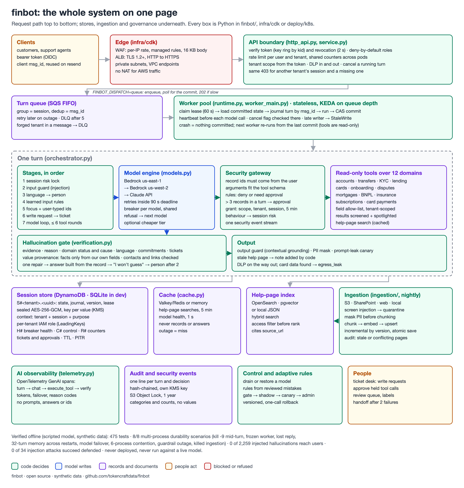

# finbot documentation

Start with the one-page diagram, then read in the order that fits your question.

| If you want to know | Read |
|---|---|
| Which requirements are met, with evidence | [requirements.md](requirements.md) |
| Why it is built this way | [decisions.md](decisions.md) (13 architecture decisions) |
| The layers, patterns and deployment overview | [design.md](design.md) |
| Clarification questions, Bayesian beliefs, information gain, decision value and research scope | [clarification/design.md](clarification/design.md) |
| Try message-driven clarification, uncertain replies and corrections | [clarification/conversation.md](clarification/conversation.md) |
| Reproduce synthetic clarification results | [clarification/experiments.md](clarification/experiments.md), [results](../results/clarification/README.md) |
| Original structured probes, exports, response fitting and model freezing | [clarification/study.md](clarification/study.md) (v1 engineering pilot) |
| Components, interfaces, data model, resiliency, reconciliation, capacity, compliance | [technical-design.md](technical-design.md) |
| How a release is cut, checked, rolled out and rolled back | [release.md](release.md) |
| Security: injection, red team, PCI, keys, identity | [security.md](security.md), [agent-security.md](agent-security.md) |
| Crash recovery, the session store, hallucination control | [reliability.md](reliability.md) |
| Adding a product area, and where the design does not fit | [domains.md](domains.md) |
| Scaling to many agents and many tenants | [platform-design.md](platform-design.md) |
| NAACL manuscript, submission checklist and reviewer walkthrough | [papers/naacl-2027/README.md](papers/naacl-2027/README.md) |
| Financial checks, policy verification and optional guardrails | [verification/layers.md](verification/layers.md) |
| What changed in each version | [../CHANGELOG.md](../CHANGELOG.md) |

Diagrams (SVG and 2x PNG, drawn by `diagrams/make.py`): the whole system, the turn pipeline,
the hallucination gate, a domain plug-in, and the security layers.

The evidence inspector runs offline with a scripted model and synthetic data. AWS deployment
and new optional guardrail paths require their own validation.
