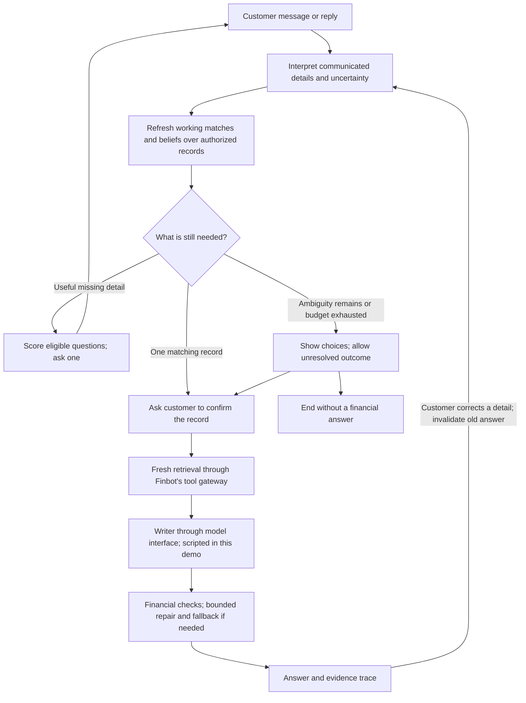

# Clarification: design, mathematics, evidence and next steps

This guide consolidates the clarification work on `abose/finbot-clarification-experiments`.
The aim is to identify which authorized payment record a customer means before
Finbot explains its financial details. Customer statements can be incomplete,
uncertain, mistaken, or corrected. A belief about intent is not a financial fact.

## Start here

```sh
python -m finbot.demo --port 8766
```

| Page | Purpose | Status |
|---|---|---|
| <http://127.0.0.1:8766/study> (also `/`) | Message-driven conversation; consumes supplied details, handles tentative recollections and corrections | Current v2 demonstration; rules and assumed probabilities, no live LLM |
| <http://127.0.0.1:8766/clarification> | Compare fixed, information-gain, decision-value and no-question selectors; inspect scores | Original mathematical inspector with scripted scenarios |
| <http://127.0.0.1:8766/study/probes> | Structured response collection, exports and calibration workflow | v1 engineering pilot; complete task cards make it unsuitable as evidence of realistic clarification benefit |
| <http://127.0.0.1:8766/inspector> | Inspect retrieval, verification, repair and fallback | Existing offline Finbot evidence inspector |

The current conversation replaces the quiz-like experience. The customer sends a
message; private role-play notes are optional and collapsed. The evaluator's preset
target is separate and cannot change the assistant's interpretation or question choice.
This separation is tested. Neither demonstration exports nor unit-test successes
are human participant results.

## Where clarification fits



The bounded clarification loop is implemented in code. It is not a learned RL
policy or an LLM autonomously choosing tools. Existing model interfaces and financial
guards remain downstream: confirmation supplies a record reference, the tool layer
refetches that record, and the verifier checks the answer. Probability never grants
access or bypasses these checks. The demo uses the local guardrail and scripted writer;
available cloud model/Bedrock adapters are not exercised by this workflow.

## What the symbols mean

| Symbol | Meaning |
|---|---|
| $Z=z$ | The record the customer intends; the implementation uses record IDs |
| $h$ | Information communicated so far |
| $E$ | Authorized candidate metadata/evidence available to the system |
| $b(z)=P(Z=z\mid h,E)$ | Current belief over intended records |
| $q$ | A candidate clarification question, including its options |
| $Y=y$ | The observed reply/category, such as “Bank transfer” |
| $P(y\mid z,q,h,E)$ | Response model: how likely that reply is if the intended record is $z$ |
| $b^{q,y}(z)$ | Belief after asking $q$ and observing $y$ |

For example, this original inspector event supplies an observation $y$, not $z$:

```json
{"type": "reply", "template": "kind", "text": "Bank transfer"}
```

`kind` identifies the question type. “Bank transfer” can describe multiple records;
it does not identify a transaction ID by itself. The new conversation API instead
accepts `{"type":"message","text":"I think it was a bank transfer"}` and visibly
interprets the supplied detail and its tentative wording.

### Updating beliefs: Bayesian inversion

The response model describes the forward direction, from intended record to a
possible reply. Bayes' rule inverts it after a reply is observed:

$$
b^{q,y}(z)=P(Z=z\mid h,E,q,Y=y)
=\frac{P(y\mid z,q,h,E)b(z)}{\sum_{z'}P(y\mid z',q,h,E)b(z')}.
$$

Writing $b'(z\mid Y=y,q,h,E)$ is another way of making the conditioning explicit.
The notation $b^{q,y}(z)$ already includes that conditioning; it is not an
unconditional distribution. These beliefs are conversation state, not updates to
LLM weights.

For the two-record teaching example, suppose $b(\text{card})=0.6$ and
$b(\text{transfer})=0.4$, and assume a binary reply channel with 90% correct reports
and no unknown replies. Then

$$
P(Y=\text{transfer})=0.4(0.9)+0.6(0.1)=0.42,
\qquad
P(Z=\text{transfer}\mid Y=\text{transfer})=\frac{0.36}{0.42}=0.8571.
$$

The 0.4 is the prior mass on the transfer record. The 0.9 is a different quantity:
the assumed chance of reporting “transfer” conditional on intending that record.
Among 100 hypothetical cases, 36 correct transfer reports and 6 mistaken transfer
reports yield 42 reports of “transfer”. The 90% assumption has not been measured
from people; it is not produced by an LLM confidence score.

### Entropy and information gain

$$
H(b)=-\sum_z b(z)\log_2 b(z),\qquad
IG(q)=H(b)-\sum_y P(y\mid q,h,E)H(b^{q,y}),
$$

where $P(y\mid q,h,E)=\sum_z P(y\mid z,q,h,E)b(z)$.
Entropy is uncertainty in bits, not an error percentage. For two records, 50/50
has entropy 1 bit, 60/40 has entropy 0.970951 bits, and certainty has entropy 0.

Before asking a question, enumerate its possible replies, calculate each reply's
probability and posterior, and average the resulting entropies. For the binary
90%-reliable example:

| Possible observed reply $y$ | $P(Y=y)$ | $P(Z=\text{card}\mid Y=y)$ | $P(Z=\text{transfer}\mid Y=y)$ | Posterior entropy |
|---|---:|---:|---:|---:|
| Card | 0.58 | 0.9310 | 0.0690 | 0.362051 bits |
| Transfer | 0.42 | 0.1429 | 0.8571 | 0.591673 bits |

Thus $IG(q)=0.970951-[0.58(0.362051)+0.42(0.591673)]=0.512458$ bits.
This is an expected reduction before seeing the reply; a particular reply may
reduce uncertainty by a different amount or even increase it.

The implemented channel also allows “I'm not sure”. With unknown probability
$u$ and accuracy $a$ conditional on a definite reply, its probabilities are $u$
for unknown, $(1-u)a$ for the matching option and $(1-u)(1-a)/(K-1)$ for each of
the other $K-1$ options. With $a=0.9,u=0.1$, the binary gain is **0.461212 bits**,
not 0.512458. Unknown is assumed equally likely for every target and leaves the
belief unchanged; this is a modeling assumption that needs empirical checking.

### Decision value and stopping

For zero-one wrong-record loss and a maximum-probability (MAP) choice, use
$R(b)=1-\max_z b(z)$. The one-question decision value is

$$
\operatorname{Value}(q)=R(b)-\sum_y P(y\mid q,h,E)R(b^{q,y})-\lambda c(q).
$$

It asks whether the expected reduction in decision error is worth the question's
cost. Cost must be expressed in the same loss units; the prototype's 0.02 is an
experimental setting, not a measured financial or user-effort cost.

For the 60/40 prior and binary channel **without unknown replies**:

| Assumed reply accuracy | Information gain | MAP error before | Expected MAP error after | Value at cost 0.02 |
|---|---:|---:|---:|---:|
| 90% | 0.512458 bits | 0.40 | 0.10 | 0.28 |
| 55% | 0.006937 bits | 0.40 | 0.40 | -0.02 |
| 50% | 0 bits | 0.40 | 0.40 | -0.02 |

At 55%, either reply leaves card as the MAP choice. Small information gain does
not necessarily improve this decision. These error calculations describe the
simulator's MAP metric; the running demo still requires explicit confirmation.

## Which question comes first, and what happens next?

1. Read the customer's message and identify details already supplied or unavailable.
2. Build eligible questions from the fixed bank: payment type, recipient, date.
   A question must distinguish candidates. The v2 page also excludes details already
   supplied, unknown/unavailable details, and previously asked question types.
3. Score eligible questions under the current response model. The information-gain
   selector chooses the highest positive gain; the alternative decision-value selector
   chooses the highest positive net value. These are one-step, greedy selectors.
4. Ask one question. After the actual reply, update the beliefs and recompute which
   remaining question is useful. Do not follow a fixed “transfer branch” blindly
   when several transfers remain or the reply is tentative.
5. Stop elicitation when the applicable workflow has enough identifying information,
   no useful eligible questions, or an exhausted budget. Show a matching record for
   confirmation or allow an unresolved outcome. An explicit correction replaces
   previous details and invalidates old financial evidence.

The simulator and original inspector expose multiple strategies and a 0.95
confidence stopping threshold. The v2 conversation uses information gain among
**working matches** and does not use that threshold as its stopping rule. It goes
straight to confirmation when one record matches the latest explicitly supplied
details. Tentative details affect beliefs while preserving alternatives. It uses
the latest observation per field rather than counting a repeated statement as
independent evidence. A still-useful pending question is retained when a message
does not answer it. See the [v2 guide](conversation.md) for exact rules.

Explicit statements define the customer's working reference, not verified intent.
The belief display can therefore retain nonzero mass outside those working matches.
Both are distinct from record facts. A mistaken confirmation can produce a supported
answer about the wrong record, so selection correctness and answer factuality must
be evaluated separately.

## What is implemented, and what remains proposed?

| Component | Current state |
|---|---|
| Finite question bank, Bayes update, entropy, information gain, decision value | Implemented in [`finbot/clarification.py`](../../finbot/clarification.py) |
| Message interpretation, private-reference separation, corrections, avoiding redundant questions | Implemented with limited rules in [`finbot/clarification_conversation.py`](../../finbot/clarification_conversation.py) |
| Reply reliability | Hand-set in demonstrations/simulation; 0.65 for tentative v2 recollections is also assumed |
| Response fitting and model freeze | Implemented for v1 structured exports; not a calibrated v2 language model |
| Human reply collection and independent answer judgments | Not performed; a realistic v2 protocol and fresh materials are still needed |
| Live LLM interpretation or question phrasing | Proposed; not implemented in the clarification loop |
| Learned participant/factor model, RL or multi-step optimal planning | Proposed research directions; not trained or established by current results |
| Real candidate discovery, missing-record retrieval and deployment | Fixed authorized synthetic catalogue only |

The course connection is Bayesian inversion and sequential information gathering.
Conditioning replies on a hidden intended record gives a simple generative model.
A factorization across question types makes inference tractable, but independent
reply errors may be false, especially when a person consistently remembers a
different transaction. A future latent reliability/factor model would need collected
data, identifiability checks and held-out comparison; the current implementation
does not estimate such factors or learn a policy.

A future LLM can interpret richer language into a validated detail schema and
paraphrase approved questions. The explicit selector, scope restrictions,
confirmation and financial checks should remain reviewable. Model-generated
confidence is not a substitute for a measured response channel. No particular
model provider or subscription is required for the offline implementation.

## What the experiments actually show

The stored reports enumerate **24 authored development families × 5 response
regimes × 5 strategies/controls = 600 comparison rows per question budget**. The
one- and two-question reports use the same families. These are not 1,200 independent
human cases and not the previously discussed Banking77-derived cases. Banking77
intent/tool-call checks do not measure clarification reply reliability or final
answer correctness.

Under matched reliable assumptions, information gain gives 68.40% expected MAP
record-selection accuracy versus 65.08% for fixed order at budget one. At budget
two they are effectively tied (73.86% versus 73.87%). With an overconfident response
model, information gain at budget two gives 48.75%, slightly below the no-question
baseline's 48.89%. These are exact synthetic expectations, not measured improvements
for people or live models, and do not evaluate the new v2 interpretation rules.

Full results and source hashes: [results/clarification](../../results/clarification/README.md).
Reproduction: [experiment guide](experiments.md).

## Next empirical steps

1. Prepare new scenario families with independent target records and realistic
   partial, uncertain, mistaken, contradictory, corrected and missing-target inputs.
   Keep the customer's information, sent message and evaluator truth separate.
2. Collect consented development replies. Independently annotate intended reference,
   communicated details, uncertainty, and parser/LLM interpretation errors. Estimate
   reply channels with counts and uncertainty; keep v1 and v2 protocols separate.
3. Freeze task materials, parser/LLM configuration, response model, question policy,
   budget, cost and endpoints. Reserve new participants and related scenario families
   for evaluation, without tuning on their responses.
4. Compare no-question, fixed-order, information-gain and decision-value policies
   under a prespecified protocol. Measure correct record selection, unsafe selection,
   appropriate unresolved cases, questions/effort, correction recovery and independently
   judged financial support. Account for repeated observations within participants.

The defensible paper direction is an inspectable system for clarification and
financial verification under uncertain customer input. Bayesian updating,
information gain and bounded repair are established techniques. Impact and empirical
benefit still need demonstration; adding them alone does not establish a novel
learning algorithm. The paper should distinguish implemented behavior, synthetic
findings, future live integration and future human evidence.
