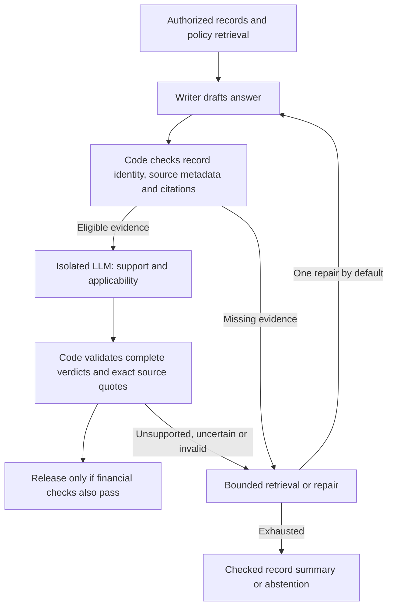

# Hybrid verification: code constraints plus LLM review

The opt-in `hybrid` policy mode addresses a limitation of `strict`: a financially correct
paraphrase can be rejected simply because it does not copy the full passage. An LLM can
judge whether a paraphrase preserves meaning and whether a rule applies to the current
question. These judgments remain fallible. This branch implements the protocol and tests
its integration; it does not yet demonstrate improved live-model accuracy.

## Flow



This reuses the existing model adapter and strong-model chain. It adds no provider account,
subscription or model-training requirement. On a live provider, review is an additional
billed model request for each eligible draft/repair. Existing deadlines, retry/failover
configuration and turn accounting apply. The reviewer receives no tools or conversation
history. The offline inspector continues to use its extractive baseline.

## Evidence and decision contract

- Code requires retrieved, cited documents with valid chunk IDs, positive versions and
  dates within `FINBOT_KB_MAX_AGE_DAYS`. Missing retrieval, invalid metadata and citations
  cannot be waived by the reviewer. Only eligible sources are sent for review.
- When the session has a focused record, its current-turn lookup must exist and identify
  the same record. The latest lookup replaces earlier snapshots; a final not-found/error
  result cannot be overridden by an older found record. General questions retaining an
  unrelated focus may consequently need a fresh lookup or abstention.
- The review payload contains the masked current question, full answer, focused record ID,
  evaluation date, numbered statements and their allowed source IDs. User assertions are
  task context, not authoritative financial evidence. Third-party record fields are removed.
- The LLM returns `verdict` (semantic support) and `applicability` for every statement, each
  one of `supported`, `unsupported` or `uncertain`. Compound statements must be reviewed in
  full. Both dimensions must be supported before release.
- Each supported statement requires a literal quote from an allowed document. If a record
  is focused, it also needs a quote from that record. Code checks quote locations and
  complete coverage, rejects invented/uncited quotes, and rejects duplicate or missing
  statement IDs. Quote presence does not prove that the quote justifies the judgment.
- Verbatim quotations also undergo semantic review: an exact sentence can omit a relevant
  exception or describe an obsolete rule. Only exact abstentions and canonical record
  summaries bypass the reviewer; summaries still pass the financial chain.
- Unsupported/uncertain verdicts, outages, malformed responses and review-budget exhaustion
  block the candidate and enter existing recovery. A model approval cannot override an
  amount mismatch, wrong returned record ID or another deterministic financial rejection.

The original `model` mode remains available as a baseline. Unlike that mode, hybrid review
requires eligible policy retrieval even when the writer omits it and receives the current
question plus explicit applicability verdicts. Free-form record-only answers still require
recovery to a canonical summary; this implementation does not infer which prose is exempt
from policy review using a fallible claim classifier.

## Example

Policy: "Domestic transfers qualify for a fee refund. International transfers are excluded."

A faithful general explanation such as "Fee refunds are available for domestic transfers
but not international transfers" can pass when the reviewer returns supported verdicts
with genuine quotes. Strict whole-passage matching rejects this paraphrase.

For "Does my transfer qualify?", an international record should produce an unsupported
applicability verdict for "Your transfer qualifies". Missing region/eligibility information
should produce uncertainty. These are desired semantic behaviors; mocked tests establish
the gate's response to those verdicts, not a real model's ability to choose them correctly.

## Enable and evaluate

On a normal application with an already configured live provider, opt in by setting:

```bash
export FINBOT_POLICY_VERIFICATION=hybrid
export FINBOT_KB_MAX_AGE_DAYS=540
```

No live calls were made while implementing this change. `FakeLLM` is a scripted writer,
not a semantic reviewer; use the dedicated mocked protocol tests for offline validation:

```bash
python -m unittest discover -s tests -p test_hybrid_policy.py -v
```

Before reporting improvement, freeze independent examples and labels for support and
applicability. Include faithful paraphrases, negation, exceptions, obsolete rules, missing
eligibility fields, mismatched records and malicious instructions embedded in evidence.
Have human reviewers label the examples without seeing model verdicts. Compare strict,
original model review and hybrid review on identical evidence and candidate answers, then
measure end-to-end task completion with fixed writer/tool/repair budgets. Include a
matched-evidence model baseline so source filtering is not mistaken for better semantics.

Report unsupported releases, false rejections, abstentions, complete supported answers,
reviewer calls, total tokens/cost and latency. Use different writer/reviewer models as an
additional comparison when feasible, not as a guarantee of independence. Shared mistakes,
prompt injection, incomplete retrieved context and wrong source material remain risks.
Effectiveness and novelty need evidence beyond adding an LLM judge.
