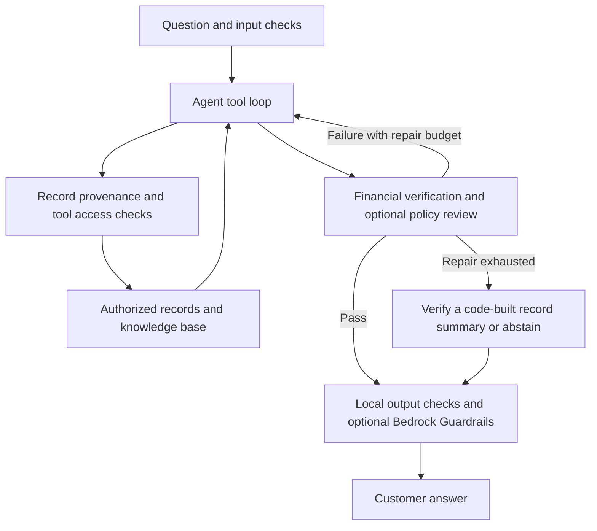

# Financial verification and bounded recovery

Finbot keeps its own financial checks as the decision gate. The agent chooses read-only
tools, sees their results and drafts an answer. Code controls record access, evidence
eligibility, the verifier chain and the repair budget. This is a system design, not a
new model or a claim of superiority over the related work below.

The default is one repair, with up to six tool rounds per model pass. Repair uses the
same tool gateway, record restrictions, per-turn tool budget and deadline as the initial
draft. A policy reviewer has no tools and cannot approve a tool call. Existing deadline
checks prevent starting model requests after the deadline; they do not cancel an
already-running synchronous provider request.

## The five layers and their implementation status

| Layer | Status | Purpose |
|---|---|---|
| Finbot checks | Active | Record binding, amounts, status, causes, retry policy, commitments and fallback verification |
| CaMeL-inspired restrictions | Active, partial | Record IDs come from the user's session; third-party fields cannot support factual checks |
| Bedrock Guardrails | Optional adapter | Additional topics, content, PII and contextual-grounding checks; local checks still apply |
| NeMo Guardrails | Deferred | A possible future conversation controller; no NeMo runtime or dependency is installed |
| RARR-inspired policy review | Optional; extractive mode enabled in the demo | Check policy statements against retrieved evidence and feed failures into bounded repair |

`finbot/provenance.py` removes entire third-party fields, including nested objects, lists
and numbers, from the evidence used by the verifier chain and Bedrock grounding. The
screened original remains available to the model and diagnostic inspector. This is a
field-name policy, not authenticated data lineage or CaMeL's capability interpreter.
Adapters must classify new external fields correctly. Authorization still comes from
the session and tool gateway; it is not granted by the evidence filter.

## Policy-document verification

Choose `FINBOT_POLICY_VERIFICATION` for the normal application:

| Value | Behavior | Additional model calls |
|---|---|---|
| `off` (default) | Existing financial checks and citation checks only | None |
| `extractive` | Each non-abstention statement must equal a complete sentence from a source cited in the same paragraph | None |
| `model` | Review each statement against cited documents and retrieved record evidence, including conditions and exceptions | At most one review request per checked draft/repair; normal provider retries/failover can add attempts |
| `strict` | Require complete cited passages with dated/versioned evidence; review runs even without a KB lookup. Only exact abstentions and canonical record summaries are exempt. | None for verification; ordinary bounded repair can still call the writer |
| `hybrid` | Enforce source/record requirements, then review both semantic support and applicability to the question. Faithful paraphrases can pass. | At most one review request per checked draft/repair; provider retries/failover can add attempts |

The local inspector explicitly selects `extractive`, irrespective of environment variables.
It never enables a live provider. For a normal application that already has a configured
model provider, opt in with `FINBOT_POLICY_VERIFICATION=model`. No new account or provider
is selected automatically. Review uses the configured strong model chain; it may therefore
use the same model as the answer writer and adds billed usage when that provider is live.

For the new conservative contract, set `FINBOT_POLICY_VERIFICATION=strict` on the normal
application. `FINBOT_KB_MAX_AGE_DAYS` must be positive (default 540). This mode requires the
whole retrieved chunk in one cited paragraph, a nonempty chunk ID, a positive integer
version and an ISO `YYYY-MM-DD` update date within the configured age window. It rejects
future dates, older retrieved versions of the same URL, conflicting chunk identities,
missing citations and missing retrieval. A successful record lookup also undergoes the
new `RecordIdentityVerifier`, active in all policy modes: returned IDs must match requested
IDs. Neither check replaces gateway authorization.

Strict mode deliberately rejects free paraphrases and most free-form record answers;
the existing bounded recovery can provide a checked canonical record summary. Whole-chunk
reuse preserves context within that chunk; it does not prove complete document context,
semantic applicability, authority or currentness. An update date is not a policy effective
date. See [the hardening scope and validation plan](hardening.md).

`FINBOT_POLICY_VERIFICATION=hybrid` retains the strict source metadata, citation and
missing-evidence requirements but replaces whole-passage matching with an isolated LLM
review. Every statement needs separate `verdict` and `applicability` decisions. Both must
be `supported`, with exact quotes from allowed documents and, when there is a focused
record, from its latest retrieved snapshot. Even verbatim policy passages undergo review.
The masked current question, full candidate answer and eligible evidence are supplied as
untrusted data; the reviewer has no tools or conversation history. Financial checks still
control release independently. See [hybrid verification](hybrid.md) for the
protocol, cost boundaries and evaluation that remains necessary.

The implementation is `finbot/policy_documents.py`. The original extractive/model paths:

1. Uses only the current verification snapshot's authorized, screened tool results.
2. Splits the answer into numbered statements. Document citations are scoped to paragraphs.
3. In model mode, sends only those statements and eligible evidence in a separate request,
   with an empty tool list and no conversation history.
4. Requires a supported/unsupported/uncertain verdict for every statement. Supported
   statements require exact source quotes and valid source IDs. Missing statements,
   duplicate IDs, invented quotes, malformed JSON and unavailable reviewers block the answer.
5. Passes failures into the existing repair loop. The agent can search the approved KB
   again, revise the answer and undergo the same checks. Refetched results replace the
   earlier verification snapshot; the full tool history is retained for inspection.

Limits are 24 statements and 80,000 serialized input characters per review, with a
24,000-character review response limit. Exceeding a limit blocks rather than silently
checking a prefix. Model calls are included in turn counters and review usage in telemetry.
Review text is not stored in conversation history or ordinary audit output.

The optional gate observer records statement verdicts, source quotes, chunk IDs and versions
where available. It does not expose private model reasoning. Because diagnostics contain
rejected drafts and evidence, consumers must restrict access and redact them. The demo
uses synthetic data and masks its exported trace.

## Optional Bedrock configuration

Use the existing `infra/create_guardrail.py` when deploying an AWS guardrail, then configure
`FINBOT_GUARDRAIL=bedrock`, `FINBOT_GUARDRAIL_ID`, `FINBOT_GUARDRAIL_VERSION` and `AWS_REGION`.
Model hosting and guardrail selection are independent. Creating a cloud resource and live
service validation are separate deployment steps; the offline demo does neither.

The adapter distinguishes blocked policies from PII anonymization, handles word lists and
custom regexes, and blocks unknown interventions or missing anonymized output. A detected
topic with action `NONE` does not turn anonymization into a false block. Error/unsupported
responses cannot release the draft. Third-party fields are excluded from grounding evidence.

**Automated Reasoning is not integrated.** It is a separate Bedrock feature requiring
formal policy setup and interpretation of its findings. If this adapter receives Automated
Reasoning findings, it blocks with `bedrock_automated_reasoning_not_supported` instead of
silently treating them as approval.

## Limits and evaluation

- Extractive checking tests complete sentence reuse, not semantic entailment or document
  correctness. A sentence can still depend on surrounding context. Legitimate paraphrases
  and mixed record/document answers can be rejected; this mode is intentionally conservative.
- Model review is fallible. Exact quotes establish where evidence came from, not that it
  logically supports the claim. Prompt-injection screening and structured output do not
  make the reviewer immune to malicious documents or correlated model errors.
- The `extractive` and `model` modes are triggered by a KB lookup in the current evidence
  snapshot. They do not
  establish that the agent searched for every policy-related statement. Record-only turns
  continue to use the financial checks. `strict` and `hybrid` do not have this trigger exemption.
- An exact match to the code-built record summary skips document review, while still passing
  the financial verifier chain. A multi-record fallback can be supported but incomplete.
- Policies in this repository are synthetic examples, not approved financial advice.

The tests cover contradictory policy wording with a valid citation, omitted conditions,
wrong/missing sources, incomplete reviewer coverage, invented quotes, reviewer outages,
fresh evidence on repair, nested third-party fields and mocked AWS responses. These are
engineering checks, not live-model accuracy results. Before a paper claim, compare `off`,
`extractive`, `strict`, `model` and `hybrid` under matched budgets, include a template-only baseline, and measure
false blocks, supported complete answers, repair success, latency and cost using independent
human-reviewed labels.

Related work: [RARR](https://aclanthology.org/2023.acl-long.910/),
[CaMeL](https://arxiv.org/abs/2503.18813),
[NeMo Guardrails](https://aclanthology.org/2023.emnlp-demo.40/),
[Bedrock Automated Reasoning](https://docs.aws.amazon.com/bedrock/latest/userguide/integrate-automated-reasoning-checks.html).
Finbot does not import or reproduce RARR, CaMeL or NeMo.
